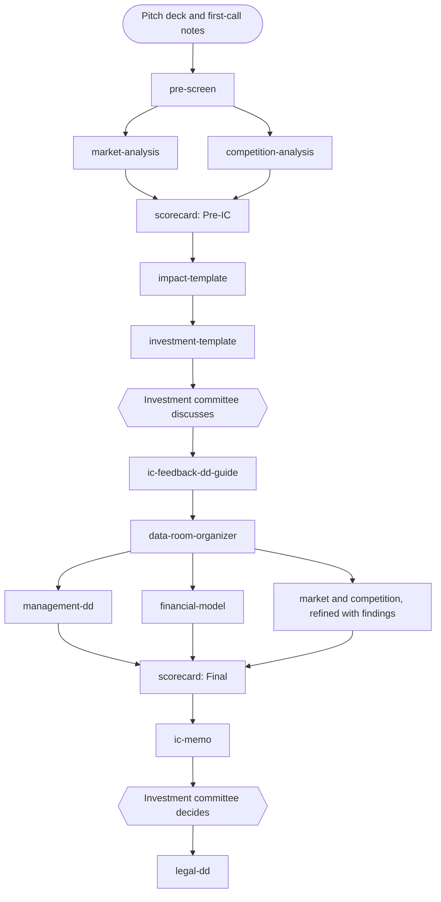

# deal-flow-agents

A team of 12 AI agents that takes a startup investment from the first pitch deck to the investment committee memo. It runs in [Claude Code](https://claude.com/claude-code).

This is a generic re-creation of the tailor-made multi-agent system I built at New Ventures Capital. I rebuilt it from scratch to show how it works. It contains none of the fund's deals, data or investment criteria.

**The original, in numbers.** These describe the system I built at the fund, not this generic copy:

- 12 agents and 17 skills, built in Claude Code with no technical background
- used by the investment team on live deals
- an estimated 60% fewer team hours per deal

## What it does

An analyst types a plain request ("run the pre-screen on Acme"). A router sends it to the right specialist agent. The agent checks that the earlier steps are done, loads its playbook, reads the deal folder, and writes one document into the folder for its stage.

IC means investment committee. DD means due diligence, the deep checks done before investing.

## Design ideas worth a look

- **Three thin layers.** A router ([`CLAUDE.md`](CLAUDE.md)) maps requests to agents. Agents ([`.claude/agents/`](.claude/agents/)) are short cover sheets: what to read, what to produce, what must exist first. Skills ([`.claude/skills/`](.claude/skills/)) hold the method.
- **One home for every fact.** The fund's filters, scoring weights and thresholds live only in [`fund-thesis`](.claude/skills/fund-thesis/SKILL.md). The format of every document lives only in [`house-style`](.claude/skills/house-style/SKILL.md). To adapt the system to another fund, you rewrite one file.
- **Agents refuse to build on nothing.** Each agent checks that the steps before it are done. If they are not, it stops, says what is missing, and asks.
- **Humans decide at the judgment calls.** Agents recommend and then wait for a yes: which facts an outside reader may see, which legal structure the company has, whether to use a placeholder number.
- **Never invent.** A missing number is marked PENDING. A careful guess is marked INFERRED. Every figure names its source.
- **Living documents.** The market and competition analyses are written once and then refined as evidence arrives. Open questions carry forward until a named call or document resolves them.

## What is in the repository

| Path | What it holds |
|---|---|
| [`CLAUDE.md`](CLAUDE.md) | The router and the workspace rules |
| [`HOW-TO.md`](HOW-TO.md) | The guide for the people who use the system |
| [`AGENT-EDITING-GUIDE.md`](AGENT-EDITING-GUIDE.md) | The rules for changing the system safely |
| [`.claude/agents/`](.claude/agents/) | The 12 agents |
| [`.claude/skills/`](.claude/skills/) | The 14 skills: 12 methods and the 2 single sources of truth |
| [`deals/_TEMPLATE/`](deals/_TEMPLATE/) | The empty deal folder, copied for each new company |
| [`deals/Monedari/`](deals/Monedari/) | The worked example |

## A worked example: one deal up to the first committee

To show the agents at work, I ran the first gate of the process on Monedari, a made-up payments startup for neighborhood shops in Mexico and Colombia. I invented its pitch deck and call notes. The five documents below are what the agents produced from that material, unedited.

| Step | Agent | What it concluded | Output |
|---|---|---|---|
| 1 | pre-screen | ADVANCE, with three flags the deck did not volunteer | [Pre-screen](deals/Monedari/0-prescreen/2026-09-24-monedari-pre-screen.md) |
| 2 | market-analysis | The deck counts 1.2 million shops in Mexico. Census data supports about 653,000 | [Market analysis](deals/Monedari/4-dd/1-market-competitive/2026-09-29-monedari-market.md) |
| 3 | competition-analysis | The two largest competitors launched the same product months before the deck, which still shows them without it | [Competition analysis](deals/Monedari/4-dd/1-market-competitive/2026-09-29-monedari-competition.md) |
| 4 | scorecard | 65 out of 100: advance, with the two findings that would turn it into a hold | [Pre-IC scorecard](deals/Monedari/2-preic/2026-10-01-monedari-pre-ic-scorecard.md) |
| 5 | impact-template | Stopped to confirm four points with the deal team, then wrote the document | [Impact template](deals/Monedari/1-impact/2026-10-02-monedari-impact-template.md) |

The inputs are in [`deals/Monedari/_inbox/`](deals/Monedari/_inbox/). The [run log](deals/Monedari/RUN-LOG.md) shows each request, which model ran it, and the one point where an agent stopped to ask a human.

The example stops where a real deal pauses: at the first investment committee, which decides whether due diligence starts. The agents for the stages after that decision work the same way.

## Run it yourself

1. Install Claude Code and open this folder in it.
2. Copy `deals/_TEMPLATE/` and rename the copy to your company.
3. Put a pitch deck in `_inbox/deck/` and type: `run the pre-screen on [Company]`.

[`HOW-TO.md`](HOW-TO.md) lists every request the system understands, in order.

## What I would build differently today

I built the original while learning, and I kept this copy faithful to it. These are the changes I would make now:

- **Stage gates in code.** Today each agent checks for earlier work by following written instructions. A small state file per deal, checked by a script, would be stricter.
- **One shared facts file per deal.** Every agent retypes key numbers from earlier documents, and a later step checks them for consistency. A number should exist once.
- **Content first, formatting second.** The original filled Word and PowerPoint templates directly, which made it fragile. I would have agents produce structured content and render the format as a separate step. This copy writes plain Markdown for that reason.
- **Tests.** A small set of past deals, re-run after every change to a skill, to catch a change that makes the output worse.
- **Sign-offs on file.** Human approvals happen in the chat. They should also be recorded in the deal folder.

## What is real and what is invented

- **Real:** the design, and every output under `deals/Monedari/` outside `_inbox/`. The market and competition research uses real, linked sources.
- **Invented:** Monedari, its people and its numbers. Example Ventures, the fund in `fund-thesis`, and all of its criteria.
- **Left out:** everything that belongs to the fund I worked for: its criteria, its scoring system, its templates and its deals.

Built by Matteo Gilliotti. All rights reserved.
